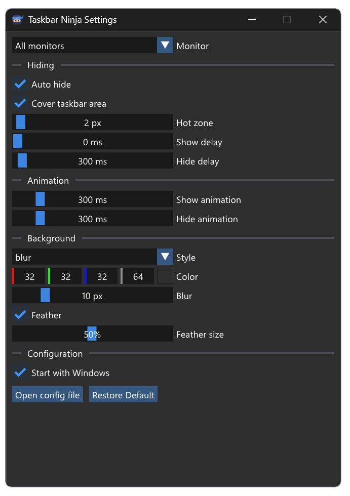

<h1 align="center">
  <br/>
  Taskbar Ninja
</h1>
<p align="center">
    Auto-hide and restyle the Windows 11 taskbar, with separate settings for each monitor.<br/>
    Protect OLED screens from taskbar burn-in, with more control than the Windows auto-hide.
</p>

> Requires Windows 11 22H2 (build 22621) or later. Tested on 24H2 (build 26100). 
> Windows 10 may work but not tested or supported.

## Features
- **Per-monitor settings.** Each monitor hides and shows on its own. The app keeps a monitor's settings while it is disconnected.
- **Adjustable timing.** Set the show delay, hide delay, hot zone size, and slide speed.
- **Stays up when you need it.** The taskbar stays shown while Start, a menu, an app preview, or quick settings is open.
- **More screen space.** Windows can fill the strip the hidden taskbar leaves.
- **Background styles.** Original, clear, tint, acrylic, or blur. Blur can fade in from the inner edge.
- **Any screen edge.** Works with the taskbar on the top, bottom, left, or right.
- **Live settings window.** Changes apply at once, with no restart.
- **Safe recovery.** A watchdog restores the taskbar if the app crashes or freezes.




## Installation
1. Download the latest release from [releases](https://github.com/sean1832/taskbar-ninja/releases/latest).
2. Keep `taskbar-ninja.exe` and `taskbar-ninja-explorer.dll` in the same folder.
3. Run `taskbar-ninja.exe`. The app adds an icon to the tray.

## Usage
### Settings window
Right-click the tray icon and choose **Settings**. A change applies when you let go of the control.

| Part | What it does |
|---|---|
| Monitor | Picks what the controls below change. **All monitors** is the base for every monitor. Then each connected monitor by model name, the primary first. Monitors that have a section in `config.ini` but are not connected come last. Hidden when you have one monitor and no monitor sections. |
| Hiding, Animation | When the taskbar hides and shows, and how fast it slides. See [Config](#config) for each value. |
| Background | Look of every taskbar. The taskbar shows the change while you drag. Only for **All monitors**. |
| Configuration | **Start with Windows** starts the app when you sign in. **Open config file** opens `config.ini`. **Restore Default** asks first, then moves `config.ini` to `config.ini.bak` and writes the default file. This removes every monitor section too. |

With a monitor picked:
- A grey value comes from **All monitors**. Change it to give that monitor its own value.
- Click **x** next to a value to use the **All monitors** value again.

With **All monitors** picked, `(set on N)` after a control means N monitors keep their own value for it. Hover it to see which ones.

A red line at the top means `config.ini` has a value the app rejected, for example from a hand edit. The app keeps the last good settings. Set the control again to write a good value.

### Tray menu
| Item | Action |
|---|---|
| Pause | Shows every taskbar and restores the original background. Click again to resume. |
| Settings | Opens the settings window. |
| Exit | Restores the taskbar and background, then closes the app. |

### Config.ini
see [Config](docs/Config.md) for the config file and its keys.

### Command line
| Command | Action |
|---|---|
| `taskbar-ninja.exe --restore` | Restores the taskbar and closes a running app. Use it if the taskbar stays hidden. |
| `taskbar-ninja.exe --configs` | Opens `%APPDATA%\taskbar-ninja` in Explorer. |

### The Explorer dll
To change the background, the app loads `taskbar-ninja-explorer.dll` into `explorer.exe`. Explorer keeps the dll loaded until Explorer restarts. Before you update or delete the dll, restart Explorer (`Task Manager > Windows Explorer > Restart`).

### Emergency restore
If the taskbar stays hidden or the app stops responding, try these in order:

1. Press `Ctrl + Alt + Shift + T`. The watchdog closes the app and restores the taskbar and background. This works while the app runs, even when it is frozen.
2. Press `Win + R` and run `"C:\path\to\taskbar-ninja.exe" --restore`. Use this if the hotkey does nothing, for example after the app closed.
3. Restart Explorer: press `Ctrl + Shift + Esc`, select **Windows Explorer**, then **Restart**. Explorer makes a new taskbar with the original look.

## Building from source
### Prerequisites
- Windows 11 22H2 or later
- CMake 3.20 or later
- Visual Studio 2022 or later, with the "Desktop development with C++" workload

### Compile
```bash
git clone https://github.com/sean1832/taskbar-ninja.git
cd taskbar-ninja
cmake -B build -G "Visual Studio 17 2022" -A x64
cmake --build build --config Release
```

The build writes `taskbar-ninja.exe` and `taskbar-ninja-explorer.dll` to `build/Release`.

The tray tooltip shows the version. It is `dev` unless you set it when you configure:

```bash
cmake -B build -G "Visual Studio 17 2022" -A x64 -DTASKBAR_NINJA_VERSION=1.2.0
```

CMake keeps this value in `build`. To change it, run the command again with a new value, or delete `build`.

If the link step fails because `taskbar-ninja-explorer.dll` is in use, restart Explorer and build again.

## Acknowledgements
- [Per-Monitor Taskbar](https://github.com/nikoleinonen/per-monitor-taskbar) by Leiksa, MIT License. Hide and show of each taskbar, the work area, and crash recovery.
- [TranslucentTB](https://github.com/TranslucentTB/TranslucentTB), GPL-3.0. Loading the dll into Explorer, the taskbar XAML element names, the blur brush, and Start and search detection.

## License
```
Taskbar Ninja - auto-hide and restyle the Windows 11 taskbar
Copyright (C) 2026 Zeke Zhang

This program is free software: you can redistribute it and/or modify
it under the terms of the GNU Affero General Public License as published
by the Free Software Foundation, either version 3 of the License, or
(at your option) any later version.

This program is distributed in the hope that it will be useful,
but WITHOUT ANY WARRANTY; without even the implied warranty of
MERCHANTABILITY or FITNESS FOR A PARTICULAR PURPOSE.  See the
GNU Affero General Public License for more details.
```

See [LICENSE](LICENSE) for the full text.
